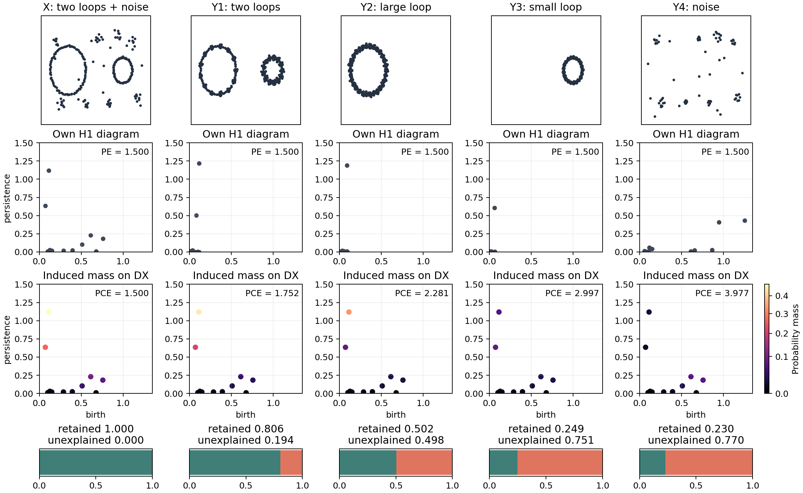
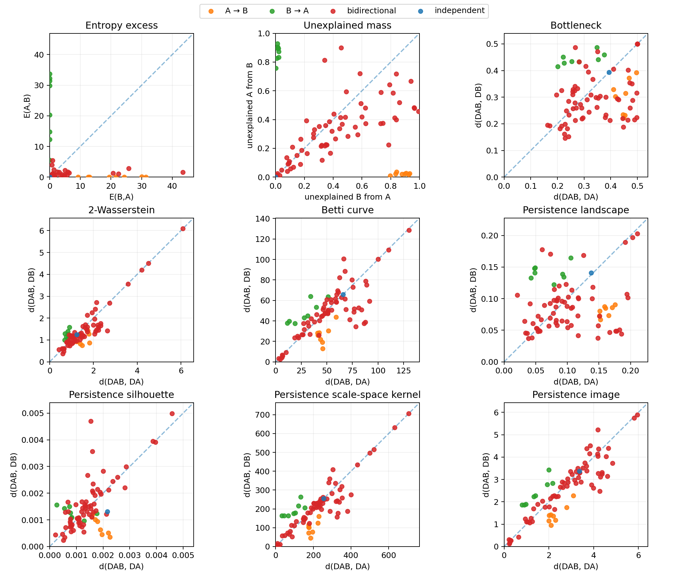

# Persistent Cross Entropy (PCE)

Persistent Cross Entropy compares persistence diagrams by inducing a probability
on the reference diagram plus an unexplained event. Its cross entropy is the
reference persistent entropy plus a nonnegative, directional entropy excess.

The introductory examples reproduce **Figures 1 and 2 of _Persistent Cross
Entropy_**, using the original geometry and Appendix B settings:

- **Figure 1:** two loops with nearly equal persistent entropy; the induced
  probabilities and cross entropy distinguish the four explaining clouds.
- **Figure 2:** the spring-mass benchmark, including entropy excess, unexplained
  mass and seven symmetric diagram baselines across 81 coupling pairs.

This repository also includes the current own-own PCE research API (H0/H1) and
PRL main-text TC. **The paper figure examples use explicitly fixed global widths;
the research API defaults to pairwise widths.** Their estimator settings are
listed separately below. The research defaults were adopted on 2026-10-12.

## Paper examples

```sh
python -m pip install ".[examples]"
python -m examples.figure1_two_loops --output example_outputs/figure1
python -m examples.figure2_spring_mass --output example_outputs/figure2
```

The scripts regenerate PNG figures, machine-readable CSV metrics, persistence
diagrams and settings JSON. They run locally without notebooks, external datasets
or network access. Figure 2 computes exact alpha complexes in four dimensions;
the full grid can take substantial time (four worker processes by default;
use `--workers 1` for serial execution). It caches its own generated diagrams
in the selected output directory. A small smoke check uses `--grid-size 2`, which
is a different grid and is not the full paper experiment.





| Setting | Figure 1 | Figure 2 |
| --- | --- | --- |
| Homology | finite H1, Euclidean Vietoris-Rips | finite H1, GUDHI alpha complex |
| Kernel widths (birth, lifetime) | (0.50, 0.50), fixed | (0.40, 0.15), fixed |
| Response scale | pooled positive absolute residual median, about 0.298499 | pooled absolute residual median, about 2.001779 |
| Lifetime response weight | `lifetime/(1+lifetime)` | `lifetime/(1+lifetime)` |
| Diagram preprocessing | raw coordinates; lifetime > 0.001 | square-root alpha radii; divide each diagram by its own maximum lifetime |
| Samples | 239 / 758 / 695 / 605 / 84 cloud points | RK4 dt=0.01, 10,000 updates, every 10th state; 997 delay vectors |
| Seeds / initial condition | 7, 107, 207, 307, 407 | state (x, xdot, y, ydot) = (1, 0, 0, 1) |

The response scale is calibrated once over the full figure experiment, not per
pair. The examples use augmented probability masses without renormalizing within
the reference diagram. Figure 1 computes actual cross entropy **PE + excess**;
Figure 2 plots **entropy excess** and unexplained mass. Figure 2's horizontal
coordinate is `E(B,A)`, and its vertical coordinate is `E(A,B)`. Every symmetric
baseline compares the joint diagram DAB to DA and DB. R² values are descriptive
regime-separation scores, not accuracies or permutation-test p-values. These
examples reproduce the supplied PCE manuscript; they do not establish exact
reproduction of the earlier Bando benchmark's unavailable implementation.

## Installation

Python 3.9 or newer:

```sh
python -m pip install .
```

Core dependencies are NumPy, SciPy and Ripser. PyTorch is not required.

## Current PCE API

```python
import numpy as np
from tpce import own_own_costs, direction

# H0: finite lifetimes from each space's OWN neighborhood.
x = np.array([0.1, 0.3, 0.6])
y = np.array([0.2, 0.4])
cost, sigma, metadata = own_own_costs(x, y)
score = direction(cost[0], cost[1])
print(cost, sigma, score)

# H1 uses (birth, lifetime), NOT (birth, death).
x1 = np.array([[0.1, 0.3], [0.2, 0.6]])
y1 = np.array([[0.15, 0.4]])
cost1, widths1, metadata1 = own_own_costs(x1, y1)
```

Both diagrams must use the same reference distance scale. Neighborhood choice,
embedding, normalization and reference scale are upstream choices; this PD API
does not silently choose them. Construct each space's own neighborhood with the
anchor excluded. The active H0 backend `tpce.h0_float64.lifetimes` computes
Euclidean minimum spanning tree edges in float64. `tpce.persistence.diagrams`
uses Ripser for H0/H1 and defaults to an H1 minimum lifetime of `1e-10`.

## Defaults and definition

| Setting | Current own-own PCE default |
| --- | --- |
| Bandwidth method | `pair_persistence_variance` |
| Explicit bandwidth | `None` (estimated from the pair) |
| Response scale eta | `5.0` |
| H0 input | 1D nonnegative finite lifetimes |
| H1 input | `(bars, 2)` nonnegative finite birth/lifetime coordinates |
| Mixture | equal mass per nonempty PD; lifetime weights within each PD |
| H0 width | `sigma² = 2 Var_Q(lifetime)` |
| H1 widths | `sigma_axis² = 2 Var_Q(axis)` for birth and lifetime |
| Constant H1 axes | exact Gaussian factor 1; no bandwidth floor |
| Zero-lifetime bars | ignored |
| Undefined direction | NaN; no denominator floor |

For a nonempty target A, `p_i = lifetime_i / sum(lifetimes)` and
`E(A,B) = sum_i p_i (F_B(u_i) - F_A(u_i))² / (2 eta²)`.
Each response sums a Gaussian kernel weighted by `lifetime / (1 + lifetime)`.
`own_own_costs` returns `[E(X,Y), E(Y,X)]` using the same pair bandwidth.
The score is `(E(Y,X) - E(X,Y)) / (E(Y,X) + E(X,Y))`; positive is the X→Y
convention, not a guarantee of causal identification.

The induced distribution includes an extra unexplained event. Do not normalize
it only over target bars. Empty targets use the existing mass-coarsening rule.
Both empty H1 PDs have zero costs and undefined direction. Unidentifiable H0
adaptive widths raise `ValueError`; no arbitrary floor is inserted. Fixed widths
require an explicit `bandwidth_method="fixed"` and positive `bandwidth` (two
widths for H1). Aggregate costs over times first, then form the ratio; missing
costs remain undefined rather than silently disappearing from the aggregate.

## TC and historical compatibility

`tpce.estimate_tc` consumes two time-aligned reconstructed spaces. Its defaults
are `k=20`, `theiler_full_window=0`, `batch=64` and 99% PCA energy. For causal
i→j, choose j's OWN neighbors and map their same-time coordinates forward to i.
Outputs carry `tc_main_text_source_neighbors_v1`. The interpretation that
conflicting supplement labels are a typo is a working assumption, not author
confirmation.

`TPCEConfig`, `estimate`, `prepare`, `calibrate` and `python -m tpce` retain the
**historical time-induced TPCE** estimator. They are not the current own-own
PCE entry point. Historical defaults are m=5, delay=17, k=20, KDE-CDF
normalization, full Theiler window `(m-1)*delay`, 64 calibration anchors and
256 scale samples. Historical H1 calibration remains unchanged.

## Tests

The standalone release includes portable PCE, bandwidth and paper-example tests:

```sh
python -m pip install ".[test]"
python -m unittest discover -s tests -v
```

The full research workspace additionally contains TC integration tests,
historical reference fixtures and FPRM experiments. Those are not bundled with
the standalone release. PRL snapshots, observations and experiment results are
excluded from the installable package and release bundle.
